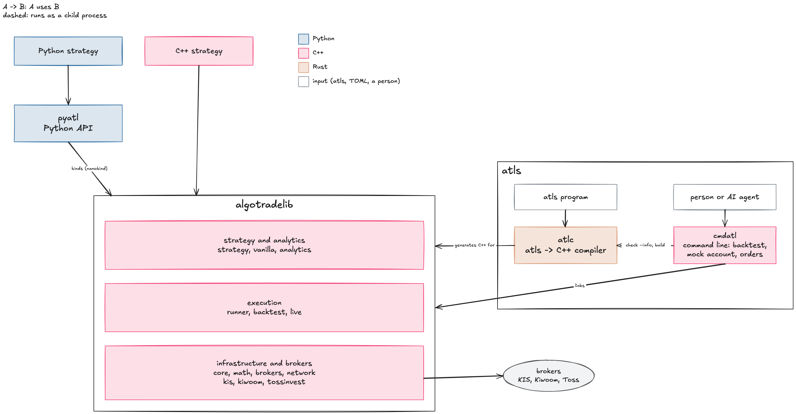

<!-- badges: start -->

<!-- badges: end -->

## algotradelib is an event-driven algorithmic trading system based on C++.

- [algotradelib](https://github.com/algotradelib/algotradelib): A header-only C++ library for algorithmic trading.
- [pyatl](https://github.com/algotradelib/pyatl): Python strategies

## atls is a strategy language that compiles to C++ as fast as a hand-written strategy.

- [atlc](https://github.com/algotradelib/atlc): The atls compiler, atls to C++
- [cmdatl](https://github.com/algotradelib/cmdatl): CLI that builds and runs atls programs, also considering agentic AI trading
